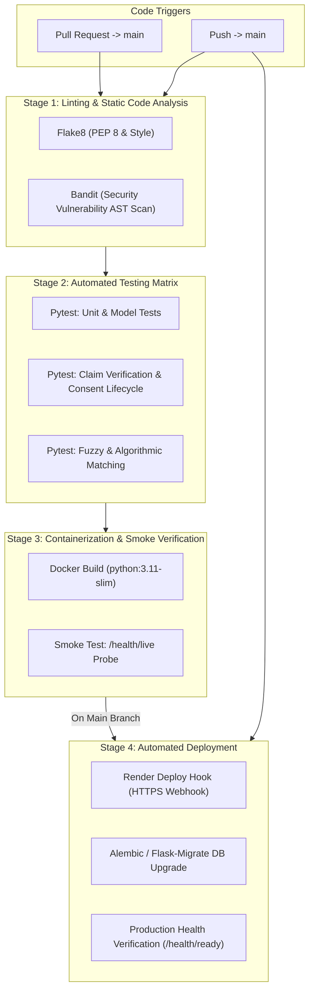

# Boomerang — Continuous Integration & Continuous Deployment (CI/CD) Pipeline

## 1. CI/CD Architecture Overview

The Boomerang deployment engineering pipeline employs GitHub Actions to establish an automated, zero-regression software delivery lifecycle. Every push and pull request undergoes rigorous automated verification before reaching staging or production environments.



---

## 2. Pipeline Stages & Jobs Specification

### Stage 1: Static Code Analysis & Linting
- **Tooling:** `flake8`, `black --check`, `isort --check-only`
- **Objective:** Enforce PEP 8 style conventions, detect unused imports, and eliminate syntax irregularities.
- **Rules:**
  - Maximum line length: 120 characters.
  - Zero tolerance policy: Any linting error halts subsequent pipeline stages immediately.

### Stage 2: Automated Test Execution
- **Tooling:** `pytest`, `pytest-cov`
- **Execution Matrix:** Python 3.11 with isolated in-memory SQLite for fast unit execution and optional PostgreSQL 16 service container for integration checks.
- **Coverage Requirements:**
  - Core domain models (`Item`, `Claim`, `Notification`, `User`).
  - Strict claim authorization logic (Student B visibility protection).
  - Algorithmic matching thresholds ($\ge 60\%$ confidence criteria).
  - In-app notification deduplication logic.

### Stage 3: Container Build & Packaging
- **Tooling:** `docker/build-push-action@v5`
- **Verification:**
  - Validates that the application container builds successfully without missing dependencies or broken wheels.
  - Performs a temporary container launch to probe `http://localhost:5000/health/live`.

### Stage 4: Production Deployment (Render + Neon)
- **Mechanism:** Triggered strictly on merges to `main` branch.
- **Execution Flow:**
  1. Triggers Render Deploy Webhook using encrypted repository secrets (`RENDER_DEPLOY_HOOK_URL`).
  2. Render pulls verified Docker image or builds from branch.
  3. Executes `flask db upgrade` during pre-deploy phase to apply pending database schema changes safely.
  4. Polls `/health/ready` to ensure the new release is actively serving requests before traffic switch.

---

## 3. GitHub Actions Workflow Configuration

Below is the production GitHub Actions workflow specification (`.github/workflows/ci-cd.yml`):

```yaml
name: Boomerang CI/CD Pipeline

on:
  push:
    branches: [ main ]
  pull_request:
    branches: [ main ]

jobs:
  lint:
    name: Code Linting & Static Analysis
    runs-on: ubuntu-latest
    steps:
      - name: Checkout Code
        uses: actions/checkout@v4

      - name: Set up Python 3.11
        uses: actions/setup-python@v5
        with:
          python-version: '3.11'
          cache: 'pip'

      - name: Install Linting Tools
        run: |
          python -m pip install --upgrade pip
          pip install flake8 bandit

      - name: Run Flake8
        run: |
          flake8 . --count --select=E9,F63,F7,F82 --show-source --statistics
          flake8 . --count --max-complexity=10 --max-line-length=120 --statistics

      - name: Run Security Scan (Bandit)
        run: |
          bandit -r boomerang/ -ll -ii

  test:
    name: Automated Pytest Suite
    needs: lint
    runs-on: ubuntu-latest
    steps:
      - name: Checkout Code
        uses: actions/checkout@v4

      - name: Set up Python 3.11
        uses: actions/setup-python@v5
        with:
          python-version: '3.11'
          cache: 'pip'

      - name: Install Dependencies
        run: |
          python -m pip install --upgrade pip
          pip install -r requirements.txt
          pip install pytest pytest-cov

      - name: Execute Pytest Suite
        env:
          FLASK_ENV: testing
          SECRET_KEY: test-secret-key
          SQLALCHEMY_DATABASE_URI: sqlite:///:memory:
        run: |
          pytest -m "not postgres" -v --tb=short

  deploy:
    name: Trigger Production Deployment
    needs: test
    if: github.ref == 'refs/heads/main' && github.event_name == 'push'
    runs-on: ubuntu-latest
    steps:
      - name: Invoke Render Deployment Webhook
        env:
          DEPLOY_HOOK: ${{ secrets.RENDER_DEPLOY_HOOK_URL }}
        run: |
          if [ -z "$DEPLOY_HOOK" ]; then
            echo "Notice: RENDER_DEPLOY_HOOK_URL not configured. Skipping deploy trigger."
          else
            curl -X POST "$DEPLOY_HOOK"
            echo "Production deployment webhook successfully dispatched."
          fi
```

---

## 4. Rollback and Incident Mitigation

In the event of an unexpected regression in production:
1. **Instant Rollback via Render Dashboard:** Revert to the previous verified deploy commit in < 30 seconds.
2. **Database Backward Compatibility:** Database migrations adhere to the "expand-and-contract" pattern (new columns are initially nullable, avoiding breaking older running instances during rollout).
