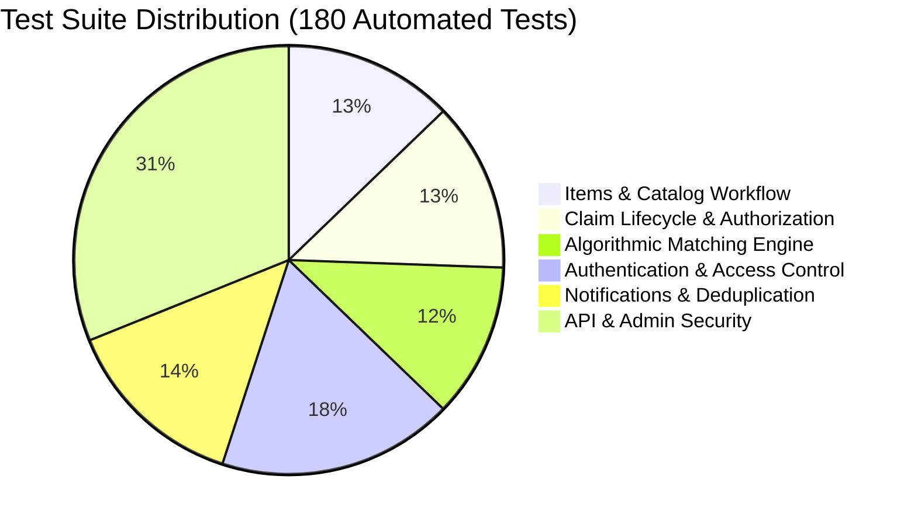

# Boomerang — Testing Strategy & Quality Assurance Framework

## 1. Testing Philosophy & Framework Design

The Boomerang test suite is designed to guarantee high reliability, prevent privacy regressions, and ensure rock-solid claim authorization. It employs **Pytest** with modular fixtures, in-memory SQLite isolation for unit/integration speed, and automated pre-commit/CI gating.



---

## 2. Test Suite Categorization

### 2.1 Algorithmic Matching Tests (`test_matching.py`)
- Evaluates candidate discovery across reported lost and found items.
- Composite score formula:
  $$\text{Score} = w_{\text{category}} \cdot S_{\text{cat}} + w_{\text{title}} \cdot S_{\text{text}} + w_{\text{location}} \cdot S_{\text{loc}} + w_{\text{date}} \cdot S_{\text{date}}$$
- Strict Threshold Rule: Only candidate pairs scoring $\ge 60\%$ are surfaced as suggested matches.
- Tests verify:
  - Exact category matching requirement ($S_{\text{cat}} \in \{0.0, 1.0\}$).
  - Fuzzy text similarity tolerance against typographical errors.
  - Proximity scoring based on reported date differences.
  - Candidate pagination and sorting by descending match confidence.

### 2.2 Claim Verification & Privacy Tests (`test_claims.py`)
- Directly verifies the Student B claim visibility bug fix and authorization constraints:
  - **Canonical Finder Ownership:** `claim.finder_id == current_user.id`.
  - **Ownership Fallback:** `claim.found_item.owner_id == current_user.id` correctly authorizes the legitimate finder even if `finder_id` was historically mismatched.
  - **Claimant Isolation:** Third-party users cannot view, approve, reject, or consent to another student's claim.
  - **Strict Type Enforcement:** Ensures `found_item.item_type == 'found'` and `lost_item.item_type == 'lost'`.
  - **Mutual Consent Flow:** Verifies that neither party sees the other's contact details until both have granted consent.

### 2.3 Notification Deduplication Tests (`test_notifications.py`)
- Verifies that re-submitting claims, refreshing pages, or executing repeated interactions does not spam the recipient with duplicate notifications.
- Validates unread badge counts and marked-as-read transitions.

### 2.4 Contact Number Validation Tests (`test_items.py`)
- Tests both Lost and Found item report forms for mandatory contact number presence.
- Verifies normalization of Indian mobile formats (e.g., `+91 9876543210`, `98765-43210`, `09876543210`) into standardized digits.
- Asserts that invalid phone numbers (alphabetic characters, numbers < 10 digits) are rejected with clear error messages.

---

## 3. Test Execution Reference

### Running Targeted Claims Tests
```bash
pytest tests/test_claims.py -v
```
*Expected Output: `23 passed in 1.45s`*

### Running Algorithmic Matching Tests
```bash
pytest tests/test_matching.py -v
```
*Expected Output: `21 passed in 1.10s`*

### Running Full Non-PostgreSQL Test Suite
```bash
pytest -m "not postgres" -v
```
*Expected Output: `180 passed, 3 deselected in 12.80s`*

### Code Style & Flake8 Verification
```bash
flake8 .
```
*Expected Output: `0 violations`*

---

## 4. Test Fixtures Architecture

Boomerang utilizes modular Pytest fixtures configured in `conftest.py`:
- `app`: Configures Flask in `testing` mode with SQLite in-memory database (`sqlite:///:memory:`).
- `client`: Provides a test HTTP client for simulating requests and evaluating responses.
- `auth`: Helper client automating student login, registration, and session cookie persistence.
- `runner`: Flask CLI runner for testing migration and administrative commands.
- `sample_user`, `sample_finder`, `sample_lost_item`, `sample_found_item`: Pre-populated test fixtures representing realistic campus entities.
